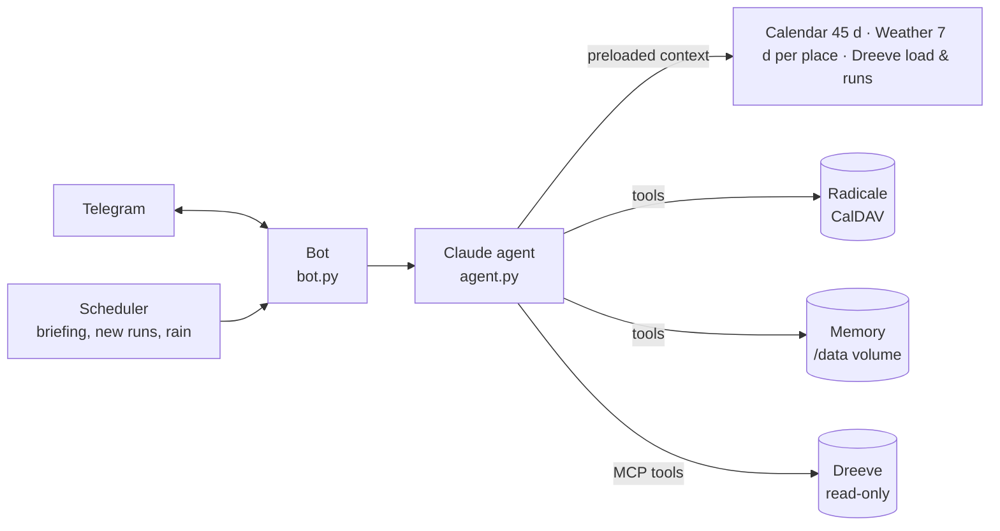

# 🏃 Running Coach — an AI running coach on Telegram

A self-hosted personal running coach that you talk to **in plain language on Telegram**.
It schedules your sessions directly in **your CalDAV calendar (Radicale)**, relies on **your real training data (Dreeve)** and the **weather**, and **learns your preferences** as you chat.

Powered by Claude (Anthropic), `claude-haiku-5-5` by default.

> 🇫🇷 **The bot speaks French**: its prompts, replies, calendar reports, alerts and commands are in French. The examples below show what it actually sends.

```text
You  ▸ Décale ma sortie longue de samedi à dimanche matin, il va pleuvoir
Coach▸ Dimanche est sec (12°C, vent faible) : sortie longue déplacée à 9h00.
       Ton TSB est à -14, garde-la en endurance fondamentale (5'40–6'00/km).
       📋 Compte-rendu Radicale (relu sur le serveur)
       - ✅ Modifié : Sortie longue 18 km (dim 15/11 09:00–10:45)
```
*("Move my Saturday long run to Sunday morning, it's going to rain" → the coach moves it, explains why, and the code appends a report of the calendar changes it verified on the server.)*

---

## ✨ Features

- **Planning in your calendar**: creates, moves, edits and deletes sessions in a dedicated CalDAV calendar.
- **Goals and periodization**: races and health goals are stored as structured data (date, target, priority). The plan is built backward from your main goal, with recovery weeks and a taper, and every reply knows the countdown.
- **Morning briefing** (configurable time): reviews training load, weather, calendar and how you've been feeling, and adjusts the upcoming days.
- **Automatic debrief** right after every run imported into Dreeve (Dreeve is checked every minute): the run vs the plan, vs your past performances, whether the coming sessions still fit, and where you stand on your goals. Then a **one-tap check-in**: perceived effort (1–10) and how your legs feel.
- **Weekly review** on Sunday evening: planned vs done (computed by the code), form, goals, next week's key sessions.
- **One-tap proposals**: when the coach suggests a change without making it, buttons let you ✅ apply, ✏️ adjust or ❌ ignore it.
- **Voice messages**: talk to the coach; voice notes are transcribed **locally** with Whisper, nothing leaves your server.
- **Persistent memory**: the coach remembers your preferences, habits, constraints, goals, injuries, food preferences and gear, and applies them every time it plans.
- **Nutrition**: `/shopping` gives a shopping list for the coming days, matched to your sport and health goals and to the sessions in your calendar, and can put it in your shopping calendar as an event with the checklist.
- **Weather alerts**: a Telegram message when rain, heat, strong gusts or ice are forecast during an upcoming session, with your other training place's forecast for comparison, an « Adapter » button, and a « bonne nouvelle » message if the forecast improves.
- **Weather per training place** (e.g. home and work): each session is planned with the forecast for where you'll actually run that day.
- **Real data**: training load (CTL/ATL/TSB, acute:chronic ratio), weekly volume, recent runs, plus every metric Dreeve's MCP server exposes (laps, zones, records…): the coach uses Dreeve's numbers instead of estimating its own.
- **Right model for the job**: Haiku for everything day to day (conversation, debriefs, daily briefing, shopping), Sonnet only for the weekly review.
- **Reliability**: every calendar write is **read back from the server**, and the report shown under each reply is **generated by the code**, not by the model, so the coach can't claim it did something it didn't.

---

## 🏗️ Architecture



| Module | Role |
|---|---|
| `running_coach/app.py` | FastAPI app (`/health`), starts the bot and the scheduler, connectivity checks |
| `running_coach/bot.py` | Telegram handlers, commands, buttons, voice, briefing, weekly review, new-run detection, weather alerts |
| `running_coach/agent.py` | System prompt, real-time context, model routing, tool loop with prompt caching |
| `running_coach/tools.py` | Tools exposed to the model (calendar, memory, goals, proposals, shopping list), action ledger, verified report |
| `running_coach/coaching.py` | Logic computed by the code: goal countdowns, check-in summary, weekly planned vs done |
| `running_coach/commands.py` | Command list, help text, instant replies |
| `running_coach/calendar_store.py` | CalDAV + iCalendar access: reads, writes verified by read-back, shopping task list |
| `running_coach/dreeve.py` | Dreeve REST API: preloaded context, new-run detection |
| `running_coach/dreeve_mcp.py` | Dreeve MCP client: on-demand detail tools |
| `running_coach/memory.py` | Persistent memory, goals, proposals, check-ins, chat history, state |
| `running_coach/weather_alerts.py` | Weather alerts: upcoming sessions × hourly forecast at their place (rain, heat, wind, ice, all-clear) |
| `running_coach/voice.py` | Local voice-note transcription (faster-whisper) |
| `running_coach/weather.py` | Open-Meteo forecasts for every training place (single request) |
| `running_coach/config.py` | Reads **all** configuration from the environment |

---

## ✅ Requirements

| Service | Required | Notes |
|---|---|---|
| [Docker](https://docs.docker.com/get-docker/) + Docker Compose | yes | any server works, a mini PC is plenty |
| [Anthropic](https://console.anthropic.com/settings/keys) API key | yes | pay-per-use, see [Costs](#-costs) |
| Telegram bot | yes | created in a minute with [@BotFather](https://t.me/BotFather) |
| CalDAV server ([Radicale](https://radicale.org)) | yes | with a **calendar dedicated to running** (the coach creates and deletes events in it) |
| [Dreeve](https://docs.dreeve.app) instance | recommended | without it the coach plans blind (no load or history) |

---

## 🚀 Quick start

```bash
git clone <repository-url> running-coach && cd running-coach
cp .env.example .env
```

1. **Fill in `.env`**: at least `ANTHROPIC_API_KEY`, `TELEGRAM_BOT_TOKEN`, `RADICALE_URL/USER/PASS`. Add Dreeve and your training places (`WEATHER_LOCATIONS`) for real coaching (see [Configuration](#️-configuration)).
2. **Start it**:
   ```bash
   docker compose up -d --build
   docker compose logs -f
   ```
   The logs show what is enabled (`[CONFIG] …`) and a check of each service (`[DREEVE]`, `[DREEVE MCP]`, `[METEO]`, `[RADICALE]`).
3. **Get your chat ID**: send any message to your bot. While `TELEGRAM_CHAT_ID` is empty, it runs in *setup mode* and only replies with your ID.
4. **Put that ID** in `TELEGRAM_CHAT_ID`, then run `docker compose up -d` to restart. The bot now only obeys you, and the briefing, debriefs and rain alerts are active.
5. **Introduce yourself** to your coach: goals, constraints, preferences. It remembers them (check with `/memory`).

### Deploying with Portainer (stack from the Git repository)

1. *Stacks → Add stack → Repository*: repository URL, reference `refs/heads/main`, path `docker-compose.yml`.
2. Under **Environment variables**, switch to *Advanced mode* and paste the content of your `.env` (the repository intentionally has none). One `NAME=value` per line: **values must fit on a single line**.
3. *Deploy the stack*. `docker-compose.yml` injects each variable (`${NAME}`); a missing variable falls back to its default.

To update: *Pull and redeploy* (no need to re-pull images, the image is built from the repository). The coach's memory lives in the `coach-data` volume and survives redeploys.

---

## ⚙️ Configuration

**All** configuration goes through environment variables (`.env` locally, the stack variables in Portainer); nothing is hard-coded. [`.env.example`](.env.example) documents every variable. Values must be on a single line.

### Required

| Variable | Description |
|---|---|
| `ANTHROPIC_API_KEY` | Anthropic API key |
| `TELEGRAM_BOT_TOKEN` | Bot token (@BotFather) |
| `TELEGRAM_CHAT_ID` | Your chat ID (quick start, step 3). Empty = setup mode. [Why it's needed](#why-telegram_chat_id) |
| `RADICALE_URL` | **Full** URL of the running calendar, e.g. `https://radicale.example.com/me/1a2b…/` |
| `RADICALE_USER` / `RADICALE_PASS` | CalDAV credentials |

### Shopping list (optional)

| Variable | Default | Description |
|---|---|---|
| `RADICALE_SHOPPING_URL` | — | **Full** URL of your dedicated **shopping calendar** (not the training one). `/shopping` creates **one event** there at your shopping time, with the checklist by aisle in its description, so it shows up in any calendar app. Each new list replaces the coach's previous upcoming list; your own events there are never touched. Empty = list in Telegram only. The older name `RADICALE_TASKS_URL` is still accepted |

### Dreeve

| Variable | Default | Description |
|---|---|---|
| `DREEVE_URL` | — | Instance root, e.g. `https://dreeve.example.com` (the older name `DREEVE_API_URL` is also accepted) |
| `DREEVE_API_KEY` | — | REST key `drv_…` (*Settings → Security → API access*) |
| `DREEVE_MCP_KEY` | — | MCP key `drvm_…` (*Settings → Security → MCP access*). **Must also be set in Dreeve's own `.env`** |
| `DREEVE_MCP_URL` | `<DREEVE_URL>/mcp` | Only change it to target an internal URL |
| `DREEVE_RUN_TYPES` | `Run,TrailRun,VirtualRun` | Activity types counted as running |

### Weather

| Variable | Default | Description |
|---|---|---|
| `WEATHER_LOCATIONS` | — | Your training places: `Maison: 48.85, 2.35 \| Travail: 48.89, 2.24`. Empty = weather disabled (the older single-place `WEATHER_LAT` / `WEATHER_LON` is still accepted) |
| `WEATHER_API_URL` | Open-Meteo | Forecast endpoint (no key needed) |

### Weather alerts

| Variable | Default | Description |
|---|---|---|
| `RAIN_ALERT_CHECK_MINUTES` | `60` | How often to check; `0` = disabled |
| `RAIN_ALERT_HOURS_AHEAD` | `48` | Sessions watched: those starting within the next N hours. The alert goes out as soon as the forecast shows rain, so with 48 you normally hear 24–48 h ahead |
| `RAIN_ALERT_PROBABILITY` | `60` | Peak rain probability over the session's slot (%) that triggers an alert… |
| `RAIN_ALERT_MIN_MM` | `0.3` | …and minimum total over the slot (mm), to ignore negligible drizzle |
| `RAIN_ALERT_SKIP_KEYWORDS` | `repos,rest,off` | Whole words in an event title that exclude it |
| `WEATHER_ALERT_HEAT_C` | `28` | Heat: peak "feels like" temperature over the slot (°C) |
| `WEATHER_ALERT_GUST_KMH` | `50` | Wind: peak gusts over the slot (km/h) |
| `WEATHER_ALERT_FREEZE_C` | `1` | Ice: minimum temperature (°C) at or below which snow, freezing rain or wet ground (rain in the 12 h before) triggers an alert |

The `RAIN_ALERT_*` variables keep their historical names but drive all weather alerts.

### Coach behavior

| Variable | Default | Description |
|---|---|---|
| `CLAUDE_MODEL` | `claude-haiku-5-5` | Model for everything except the weekly review: conversation, voice, debriefs, daily briefing, shopping, commands |
| `CLAUDE_PLANNING_MODEL` | `claude-sonnet-5-5` | Model for the weekly review only (automatic and `/review`), about once a week; set it to `claude-haiku-5-5` to use Haiku everywhere |
| `CLAUDE_MAX_TOKENS` | `16000` | Max tokens per reply |
| `CLAUDE_MAX_TOOL_ROUNDS` | `25` | Safeguard: max tool round-trips per message |
| `COACH_TZ` | `Europe/Paris` | Time zone |
| `BRIEFING_TIME` | `08:00` | Briefing time; `off` = disabled |
| `WEEKLY_REVIEW_TIME` | `sun 19:00` | Weekly review day (`mon`…`sun`) and time; `off` = disabled (`/review` still works) |
| `WHISPER_MODEL` | `small` | Whisper model for voice notes: `tiny`, `base`, `small`, `medium` (bigger = more accurate, slower, more RAM); `off` = voice disabled |
| `ACTIVITY_POLL_MINUTES` | `1` | New-run detection interval; `0` = disabled |
| `PLANNING_HORIZON_DAYS` | `30` | Days (re)planned by the briefing |
| `CALENDAR_CONTEXT_DAYS` | `45` | Days of calendar given to the coach |
| `HISTORY_MESSAGES` | `6` | Chat messages kept as history |
| `COACH_SEED_MEMORY` | — | Starting knowledge, format `category: text \| category: text` (categories: `preference`, `habitude`, `contrainte`, `objectif`, `santé`, `nutrition`, `équipement`, `autre`). Read **once**, when the memory is first created. Single line |

### Technical

| Variable | Default | Description |
|---|---|---|
| `COACH_PORT` | `18000` | Host port for `/health` |
| `COACH_DATA_DIR` | `/data` (Docker) | Persistent memory folder |
| `HTTP_TIMEOUT` | `8` | Timeout for outgoing HTTP calls (s) |
| `LOG_LEVEL` | `INFO` | `DEBUG`, `INFO`, `WARNING`… |

---

## 💬 Usage

Just talk to it (in French), for example:

- *« Planifie ma semaine prochaine, 4 séances, objectif semi en mars »* (plan next week, 4 sessions, half-marathon goal in March)
- *« Je suis crevé, allège demain »* (I'm exhausted, make tomorrow easier)
- *« Comment s'est passé mon fractionné d'hier ? »* (how did yesterday's intervals go? It fetches the laps from Dreeve)
- *« Je préfère courir le matin avant 8h en semaine »* (I prefer running before 8am on weekdays: 🧠 remembered)
- *« J'ai mal au tendon d'Achille gauche depuis lundi »* (my left Achilles has hurt since Monday: 🧠 remembered and taken into account)

| Command | Effect |
|---|---|
| `/plan` | Planned sessions for the next 7 days; `/plan 14` for 14 (max 45) |
| `/load` | Training load (CTL, ATL, TSB, A:C ratio, rest days) and the last 4 weeks' volume |
| `/runs` | Your last 5 runs |
| `/weather` | Forecast for each training place |
| `/goals` | Your goals with the countdown |
| `/memory` | Shows everything the coach knows about you, with each memory's number |
| `/debrief` | AI debrief of your latest run (same 4 parts as the automatic one, read-only), then the check-in if not done yet |
| `/review` | AI review of the current week: planned vs done, form, goals, next week |
| `/shopping` | AI shopping list for the next 7 days (`/shopping 3` for 3, max 14), built from your sport and health goals, food preferences in memory, and the sessions planned over that period; also saved as an event in your shopping calendar (`RADICALE_SHOPPING_URL`) at your shopping time, e.g. *« mets-la à 15h »* |
| `/briefing` | Runs the full briefing now: reviews everything and adjusts the plan in your calendar |
| `/help` (or `/start`) | Lists the commands |

`/plan`, `/load`, `/runs`, `/weather`, `/goals` and `/memory` answer instantly from your data, with no AI call (free). All commands appear in Telegram's `/` menu; the bot still answers in French.

**Voice messages** 🎙️: send a voice note instead of typing. It is transcribed on your server (Whisper, `WHISPER_MODEL`), echoed back so you can check it, then handled like a written message. The model is downloaded on the first voice note (~500 MB for `small`, into the `coach-data` volume) and kept in memory afterwards (about 1 GB of RAM).

**Goals**: just tell the coach, e.g. *« Semi de Paris le 7 mars, je vise 1h45 »* or *« je veux revenir à 72 kg »*. It stores them as structured goals (`🎯 Objectif enregistré` under its reply), plans backward from the main one, and shows the countdown in `/goals`.

**Proposals**: when the coach suggests a calendar change without making it (debrief, weekly review, weather alert), the message ends with the proposal and buttons: ✅ applies it, ✏️ lets you say what to change, ❌ keeps the plan as is. Each button works once.

To correct the memory: *« oublie le #3 »* (forget #3), or simply say what changed: it replaces the old memory.

### Automations

- **Briefing** every day at `BRIEFING_TIME`: fitness status, check-ins, weather, goal countdown, plan adjustments over `PLANNING_HORIZON_DAYS` days.
- **Weekly review** at `WEEKLY_REVIEW_TIME` (planning model): the code counts planned vs done for the week (a planned session counts as done if a run exists that day; runs without a planned session are listed as extra), then the coach reviews regularity, form, goals and next week's key sessions. Changes come as proposals with buttons.
- **Weather alert** (every `RAIN_ALERT_CHECK_MINUTES` minutes): for each session in the next `RAIN_ALERT_HOURS_AHEAD` hours (default 48, so you normally get the alert 24–48 h before), the code reads the **hourly forecast for the exact time slot** at the **session's place**: ☔ rain, 🥵 heat, 💨 gusts, 🧊 ice. The place comes from the event's location field, which the coach fills in itself; otherwise from a place name mentioned in the session, otherwise the first place in `WEATHER_LOCATIONS`. One alert per new hazard per session, built by the code without calling the model (free). « 🔁 Adapter » asks the coach to move or adapt the session; « 👍 Je garde » keeps it. If every hazard disappears from the forecast later, a « ✅ Bonne nouvelle » message follows (once, at least 1 h before the session). Alerts are added to the chat history, so you can also simply reply « décale-la à demain » (move it to tomorrow) or « je la fais au travail » (I'll do it from work).
  ```text
  ⚠️ Météo à surveiller sur ta séance « Fractionné 8×400 m »
  - 📅 mar 10/11 18:30–19:30 (dans 31 h)
  - 📍 Maison : ☔ pluie 80 %, 2.4 mm · 💨 vent rafales 62 km/h
  - 📍 Travail : ✅ RAS, bonne alternative
  [🔁 Adapter] [👍 Je garde]
  ```
- **Debrief** within `ACTIVITY_POLL_MINUTES` minutes (default 1) of a new run appearing in Dreeve. Each check is a single Dreeve API call; the model only runs when there is a new run. Several runs imported at once are covered together. The debrief has four short parts:
  1. 🏃 the run vs what was planned (laps/splits from Dreeve),
  2. 📈 how it compares with your similar recent runs and recent trend,
  3. 🔋 your form (TSB, A:C ratio, check-ins) and whether the coming sessions still fit, with any change only *proposed* (buttons),
  4. 🎯 progress toward your goals (countdown, training phase).

  In debrief mode the coach has **no** calendar write access: use ✅ under a proposal, or reply « ok, fais-le » (ok, do it).

  Right after, the **check-in** asks for your perceived effort (1–10) then your legs (🟢 fresh, 🟡 normal, 🟠 heavy, 🔴 pain), one tap each. The coach sees your last 14 days of check-ins (plus effort × minutes as a perceived load) in every reply and weighs them like the Dreeve data; « pain » triggers a follow-up question.

---

## 🧠 Memory

- The coach calls its own `remember` / `forget` tools whenever you express something lasting (preference, habit, constraint, goal, health, gear). It can also record a habit that is **clearly repeated** in your data.
- Every addition or removal is shown under its reply: `🧠 Noté : …` / `🗑️ Oublié : …`.
- The memory is included in every message, briefing and debrief.
- **Goals** are stored separately as structured data (`set_goal` / `remove_goal`), with date, target and priority (A = main goal of the season), shown under the reply as `🎯 Objectif enregistré : …`.
- Everything is stored together with the chat history, proposals and check-ins in the `coach-data` Docker volume (`/data/coach_state.json`) and survives restarts and updates. Limits: 80 memories of 300 characters each, 15 goals.

---

## 📊 Dreeve integration

Dreeve is used **read-only**, through two complementary channels:

| Channel | Key | When | Data |
|---|---|---|---|
| [REST API](https://docs.dreeve.app/api/) | `drv_…` | Automatically, with every message | Load (CTL, ATL, TSB, A:C ratio, TRIMP, monotony, strain), last 6 weeks' volume, last 10 runs (pace, HR, elevation, ID) |
| [MCP server](https://docs.dreeve.app/integrations/mcp/) | `drvm_…` | When the model asks | Every tool the server exposes (all read-only): laps, splits, streams, heart-rate zones, volume, activity search, shoes, streaks, and any performance metrics Dreeve provides. The tool list is logged at startup (`[DREEVE MCP] N outil(s) : …`) |

REST is enough to coach; MCP lets the coach dig deeper (detailed debriefs, paces per zone, Dreeve's own metrics, which it is told to use rather than recompute). If MCP is unavailable, the coach carries on with the REST data.

---

## Why `TELEGRAM_CHAT_ID`?

Even if you only talk to the bot in a private chat, this value is still needed. In a private chat, the chat ID is simply **your Telegram user ID**. It serves two purposes:

1. **Security**: a Telegram bot is public; anyone can find it and message it. Without this value, a stranger could control your calendar and read your training data. The bot ignores every other chat.
2. **Messages the bot starts itself**: the briefing, debriefs and rain alerts are sent without you writing first, and Telegram won't let a bot message someone without knowing their ID.

While it is empty, the bot runs in *setup mode*: it replies to every message only with the ID to put in your configuration.

## 🛡️ Safeguards

- **Single user**: the bot ignores any chat other than `TELEGRAM_CHAT_ID`.
- **Verified writes**: every create/update/delete is read back from the CalDAV server; any mismatch counts as a failure.
- **Factual report**: the list of actions under each reply comes from the code; if the model claims a change it didn't make, a warning is added.
- **The past is off-limits**: the code refuses to edit or delete past events.
- **Identification by UID**: never a fuzzy search by title.
- **One run at a time**: no concurrent calendar writes.
- **Dreeve read-only**: no write calls at all.

---

## 💶 Costs

The only paid service is the Anthropic API. Conversation, debriefs and commands use Claude Haiku 5.5 ($0.10 / M input tokens, $0.50 / M output tokens): with **prompt caching** on the tool loop, a message typically costs a fraction of a cent. The daily briefing runs on Haiku too. Only the weekly review uses Claude Sonnet 5.5 ($2 / M input, $10 / M output): about one run a week, typically a few cents; set `CLAUDE_PLANNING_MODEL=claude-haiku-5-5` to keep everything on Haiku. Voice transcription runs locally and costs nothing. Token usage (including cache reads) is logged after every reply (`Tokens : {...}`, with the model used).

---

## 🔒 Data and privacy

- **Secrets**: only in your environment (`.env` / stack variables), excluded from Git (`.gitignore`) and from the Docker image (`.dockerignore`). The code contains no key, URL or personal data.
- **Sent to Anthropic** with each message: your message (for a voice note, its transcription: the audio itself never leaves your server), the upcoming calendar, the weather, the Dreeve data, your memory, goals and check-ins. Nothing else leaves your server.
- **Stored locally**: memory + the last 3 exchanges in the `coach-data` volume. To wipe everything: `docker compose down -v`.

---

## 🧑‍💻 Development

Managed with [uv](https://docs.astral.sh/uv/).

```bash
uv sync                                          # dependencies (pytest included)
set -a && . ./.env && set +a                     # load the configuration
uv run uvicorn running_coach.app:app --reload    # run locally (memory in ./data)
uv run pytest                                    # tests
```

Tests need no keys and no network: Claude, Dreeve and MCP calls are mocked. They also check that every variable read by the code is passed by `docker-compose.yml` and documented in `.env.example`.

---

## 🩺 Troubleshooting

| Symptom | Likely cause |
|---|---|
| `[CONFIG] … manquante` at startup | A required variable is empty in `.env` (or in the Portainer stack variables) |
| Portainer: `invalid environment variable: =` | A value spread over several lines (often `COACH_SEED_MEMORY`) or an empty row in the stack variables. Keep every value on one line |
| Portainer: `env file … .env not found` | Outdated `docker-compose.yml`: update the repository (*Pull and redeploy*) |
| A new variable from `.env.example` has no effect | It must also be listed in `docker-compose.yml` (a test checks this) |
| The bot replies « Configuration : ajoute TELEGRAM_CHAT_ID=… » | Expected while `TELEGRAM_CHAT_ID` is empty (quick start, step 3) |
| `[DREEVE MCP] Connexion impossible …` | `drvm_…` key missing or wrong here **or in Dreeve's own `.env`**; don't confuse it with the REST key `drv_…` |
| `[DREEVE] … HTTP 401` | `DREEVE_API_KEY` invalid, or not set on the Dreeve side |
| `[RADICALE] Échec de connexion CalDAV` | `RADICALE_URL` must point to the **calendar** (with its ID), not the server root |
| Sessions are one hour off | Check `COACH_TZ` |
| No weather in replies | `WEATHER_LOCATIONS` empty or malformed (startup fails with an explicit message if the format is wrong) |
| `❌ Liste de courses non enregistrée dans Radicale` | `RADICALE_SHOPPING_URL` must be the **full** URL of the shopping calendar (with its ID), different from `RADICALE_URL` |
| First voice note is slow | Expected: the Whisper model is downloaded once (`[VOIX] Chargement du modèle …` in the logs), then kept in memory |
| Voice transcription is often wrong | Try `WHISPER_MODEL=medium` (more accurate, slower, ~1.5 GB) |

## License

MIT — see [LICENSE](LICENSE).
