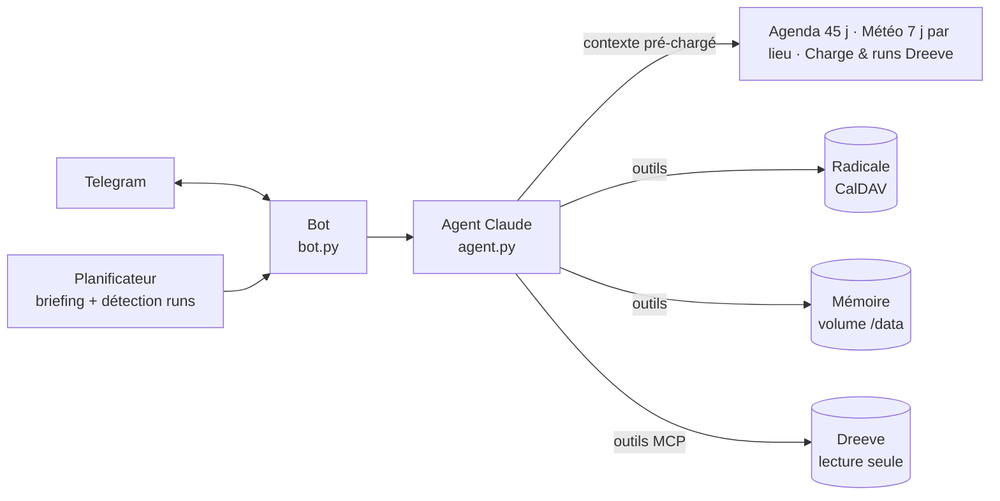

# 🏃 Running Coach — agent de coaching running sur Telegram

Un coach running personnel, auto-hébergé, que tu pilotes **en langage naturel depuis Telegram**.
Il planifie tes séances directement dans **ton agenda CalDAV (Radicale)**, s'appuie sur **tes vraies données d'entraînement (Dreeve)** et la **météo**, et **apprend tes préférences** au fil des conversations.

Propulsé par Claude (Anthropic), `claude-haiku-5-5` par défaut.

```text
Toi  ▸ Décale ma sortie longue de samedi à dimanche matin, il va pleuvoir
Coach▸ Dimanche est sec (12°C, vent faible) : sortie longue déplacée à 9h00.
       Ton TSB est à -14, garde-la en endurance fondamentale (5'40–6'00/km).
       📋 Compte-rendu Radicale (relu sur le serveur)
       - ✅ Modifié : Sortie longue 18 km (dim 15/11 09:00–10:45)
```

---

## ✨ Fonctionnalités

- **Planification dans ton agenda** : création, déplacement, modification, suppression de séances dans un calendrier CalDAV dédié.
- **Briefing matinal** automatique (heure configurable) : analyse charge + météo + agenda, et ajuste les jours à venir.
- **Débrief automatique** de chaque nouveau run importé dans Dreeve (avec tours/splits), comparé au plan.
- **Mémoire persistante** : le coach retient tes préférences, habitudes, contraintes, objectifs, douleurs et matériel, et les applique à chaque planification.
- **Alerte pluie** : un message Telegram si la pluie est prévue sur le créneau d'une séance à venir, avec la météo de ton autre lieu pour comparer.
- **Météo par lieu d'entraînement** (ex. maison et travail) : chaque séance est planifiée avec la météo de l'endroit où tu cours ce jour-là.
- **Données réelles** : charge d'entraînement (CTL/ATL/TSB, ratio aigu/chronique), volume hebdo, derniers runs, et détail à la demande via le serveur MCP de Dreeve.
- **Fiabilité** : chaque écriture dans l'agenda est **relue sur le serveur**, et le compte-rendu affiché est **généré par le code**, pas par le modèle : il ne peut pas prétendre avoir fait ce qu'il n'a pas fait.

---

## 🏗️ Architecture



| Module | Rôle |
|---|---|
| `running_coach/app.py` | Application FastAPI (`/health`), démarrage du bot et du planificateur, test de connectivité |
| `running_coach/bot.py` | Handlers Telegram, `/memoire`, briefing matinal, détection des nouveaux runs |
| `running_coach/agent.py` | Prompt système, contexte temps réel, boucle d'outils avec prompt caching |
| `running_coach/tools.py` | Outils exposés au modèle (agenda, mémoire), registre des actions, compte-rendu vérifié |
| `running_coach/calendar_store.py` | Accès CalDAV + iCalendar : lecture, écritures vérifiées par relecture |
| `running_coach/dreeve.py` | API REST Dreeve : contexte pré-chargé, détection des nouveaux runs |
| `running_coach/dreeve_mcp.py` | Client MCP Dreeve : outils de détail à la demande |
| `running_coach/memory.py` | Mémoire persistante, historique de conversation, état |
| `running_coach/rain_alerts.py` | Alerte pluie : séances à venir × prévision horaire du lieu, une alerte par séance |
| `running_coach/weather.py` | Prévisions Open-Meteo pour chaque lieu d'entraînement (un seul appel) |
| `running_coach/config.py` | Lecture de **toute** la configuration depuis l'environnement |

---

## ✅ Prérequis

| Service | Obligatoire | Notes |
|---|---|---|
| [Docker](https://docs.docker.com/get-docker/) + Docker Compose | oui | n'importe quel serveur, un mini-PC suffit |
| Clé API [Anthropic](https://console.anthropic.com/settings/keys) | oui | usage facturé à l'appel, voir [Coûts](#-coûts) |
| Bot Telegram | oui | créé en 1 minute avec [@BotFather](https://t.me/BotFather) |
| Serveur CalDAV ([Radicale](https://radicale.org)) | oui | avec un **calendrier dédié au running** (le coach peut y créer/supprimer des événements) |
| Instance [Dreeve](https://docs.dreeve.app) | recommandé | sans elle, le coach planifie à l'aveugle (pas de charge ni d'historique) |

---

## 🚀 Démarrage rapide

```bash
git clone <url-du-dépôt> running-coach && cd running-coach
cp .env.example .env
```

1. **Remplis `.env`** : au minimum `ANTHROPIC_API_KEY`, `TELEGRAM_BOT_TOKEN`, `RADICALE_URL/USER/PASS`. Ajoute Dreeve et tes lieux d'entraînement (`WEATHER_LOCATIONS`) pour un vrai coaching (voir [Configuration](#️-configuration)).
2. **Lance** :
   ```bash
   docker compose up -d --build
   docker compose logs -f
   ```
   Les logs affichent ce qui est activé (`[CONFIG] …`) et un test de chaque service (`[DREEVE]`, `[DREEVE MCP]`, `[METEO]`, `[RADICALE]`).
3. **Récupère ton id de chat** : envoie un message à ton bot. Tant que `TELEGRAM_CHAT_ID` est vide, il est en *mode configuration* et te répond seulement avec ton id.
4. **Mets cet id** dans `TELEGRAM_CHAT_ID`, puis `docker compose up -d` pour redémarrer. Le bot n'obéit désormais qu'à toi, et le briefing et les débriefs sont actifs.
5. **Présente-toi** à ton coach : objectifs, contraintes, préférences. Il les mémorise (`/memoire` pour vérifier).

---

### Déployer avec Portainer (stack depuis le dépôt Git)

1. *Stacks → Add stack → Repository* : URL du dépôt, référence `refs/heads/main`, chemin `docker-compose.yml`.
2. Dans **Environment variables**, passe en *Advanced mode* et colle le contenu de ton `.env` (le dépôt n'en contient pas, c'est voulu). Seules les lignes `NOM=valeur` comptent ; ne laisse pas de ligne vide en mode simple.
3. *Deploy the stack*. Chaque variable est injectée par `docker-compose.yml` (`${NOM}`) ; une variable absente prend sa valeur par défaut.

Pour une mise à jour : *Pull and redeploy* (cocher *Re-pull image* n'est pas nécessaire, l'image est construite depuis le dépôt). La mémoire du coach est dans le volume `coach-data` et survit aux redéploiements.

## ⚙️ Configuration

**Toute** la configuration passe par `.env` ; aucun réglage n'est codé en dur. Le fichier [`.env.example`](.env.example) est commenté ligne par ligne.

### Requis

| Variable | Description |
|---|---|
| `ANTHROPIC_API_KEY` | Clé API Anthropic |
| `TELEGRAM_BOT_TOKEN` | Token du bot (@BotFather) |
| `TELEGRAM_CHAT_ID` | Ton id de chat (voir démarrage rapide, étape 3). Vide = mode configuration. [Pourquoi c'est nécessaire](#pourquoi-telegram_chat_id-) |
| `RADICALE_URL` | URL **complète** du calendrier running, ex. `https://radicale.example.com/moi/1a2b…/` |
| `RADICALE_USER` / `RADICALE_PASS` | Identifiants CalDAV |

### Dreeve

| Variable | Défaut | Description |
|---|---|---|
| `DREEVE_URL` | — | Racine de l'instance, ex. `https://dreeve.example.com` (l'ancien nom `DREEVE_API_URL` est aussi accepté) |
| `DREEVE_API_KEY` | — | Clé REST `drv_…` (*Settings → Security → API access*) |
| `DREEVE_MCP_KEY` | — | Clé MCP `drvm_…` (*Settings → Security → MCP access*). **À définir aussi dans le `.env` de Dreeve** |
| `DREEVE_MCP_URL` | `<DREEVE_URL>/mcp` | À changer seulement pour viser une URL interne |
| `DREEVE_RUN_TYPES` | `Run,TrailRun,VirtualRun` | Types d'activités comptés comme de la course |

### Météo

| Variable | Défaut | Description |
|---|---|---|
| `WEATHER_LOCATIONS` | — | Tes lieux d'entraînement : `Maison: 48.85, 2.35 \| Travail: 48.89, 2.24`. Vide = météo désactivée (l'ancien format `WEATHER_LAT` / `WEATHER_LON`, un seul lieu, reste accepté) |
| `WEATHER_API_URL` | Open-Meteo | Endpoint des prévisions (sans clé) |

### Alerte pluie

| Variable | Défaut | Description |
|---|---|---|
| `RAIN_ALERT_CHECK_MINUTES` | `60` | Fréquence de vérification ; `0` = désactivé |
| `RAIN_ALERT_HOURS_AHEAD` | `24` | Séances surveillées : celles qui commencent dans les N prochaines heures |
| `RAIN_ALERT_PROBABILITY` | `60` | Probabilité de pluie max sur le créneau (%) à partir de laquelle prévenir… |
| `RAIN_ALERT_MIN_MM` | `0.3` | …et cumul minimal sur le créneau (mm), pour ignorer la bruine négligeable |
| `RAIN_ALERT_SKIP_KEYWORDS` | `repos,rest,off` | Mots (entiers) du titre qui excluent un événement |

### Comportement du coach

| Variable | Défaut | Description |
|---|---|---|
| `CLAUDE_MODEL` | `claude-haiku-5-5` | Modèle Claude |
| `CLAUDE_MAX_TOKENS` | `16000` | Tokens max par réponse |
| `CLAUDE_MAX_TOOL_ROUNDS` | `25` | Garde-fou : allers-retours d'outils max par message |
| `COACH_TZ` | `Europe/Paris` | Fuseau horaire |
| `BRIEFING_TIME` | `08:00` | Heure du briefing ; `off` = désactivé |
| `ACTIVITY_POLL_MINUTES` | `15` | Détection des nouveaux runs ; `0` = désactivé |
| `PLANNING_HORIZON_DAYS` | `30` | Jours (re)planifiés par le briefing |
| `CALENDAR_CONTEXT_DAYS` | `45` | Jours d'agenda fournis au coach |
| `HISTORY_MESSAGES` | `6` | Messages de conversation conservés |
| `COACH_SEED_MEMORY` | — | Connaissances de départ (format `catégorie: texte \| catégorie: texte`), lues **une seule fois**, à la création de la mémoire |

### Technique

| Variable | Défaut | Description |
|---|---|---|
| `COACH_PORT` | `18000` | Port de l'hôte pour `/health` |
| `COACH_DATA_DIR` | `/data` (Docker) | Dossier de la mémoire persistante |
| `HTTP_TIMEOUT` | `8` | Timeout des appels sortants (s) |
| `LOG_LEVEL` | `INFO` | `DEBUG`, `INFO`, `WARNING`… |

---

## 💬 Utilisation

Parle-lui normalement :

- *« Planifie ma semaine prochaine, 4 séances, objectif semi en mars »*
- *« Je suis crevé, allège demain »*
- *« Comment s'est passé mon fractionné d'hier ? »* (il va chercher les tours dans Dreeve)
- *« Je préfère courir le matin avant 8h en semaine »* (🧠 mémorisé)
- *« J'ai mal au tendon d'Achille gauche depuis lundi »* (🧠 mémorisé, pris en compte dans les plans)

| Commande | Effet |
|---|---|
| `/memoire` | Affiche tout ce que le coach sait de toi, avec les numéros des souvenirs |

Pour corriger la mémoire : *« oublie le #3 »*, ou dis simplement ce qui a changé (*« finalement je suis en télétravail le mercredi »*) : il remplace l'ancien souvenir.

### Automatismes

- **Briefing** chaque jour à `BRIEFING_TIME` : état de forme, météo, ajustement du plan sur `PLANNING_HORIZON_DAYS` jours.
- **Alerte pluie** (toutes les `RAIN_ALERT_CHECK_MINUTES` minutes) : pour chaque séance des `RAIN_ALERT_HOURS_AHEAD` prochaines heures, le coach lit la prévision **heure par heure sur le créneau exact**, au **lieu de la séance** (champ « lieu » de l'événement, qu'il renseigne lui-même ; à défaut, un nom de lieu cité dans la séance, sinon le premier lieu de `WEATHER_LOCATIONS`). Une seule alerte par séance, générée sans appel au modèle (gratuite). Elle entre dans l'historique : réponds simplement « décale-la à demain » ou « je la fais au travail ».
  ```text
  ☔ Pluie prévue sur ta séance « Fractionné 8×400 m »
  - 📅 mar 10/11 18:30–19:30
  - 📍 Maison : 80 %, 2.4 mm
  - 📍 Travail : 10 %, 0.0 mm ✅ sec, bonne alternative
  ```
- **Débrief** dès qu'un nouveau run apparaît dans Dreeve (vérifié toutes les `ACTIVITY_POLL_MINUTES` minutes). En mode débrief, le coach n'a **pas** accès à l'écriture de l'agenda.

---

## 🧠 Mémoire

- Le coach appelle de lui-même ses outils `remember` / `forget` dès que tu exprimes quelque chose de durable (préférence, habitude, contrainte, objectif, santé, matériel). Il peut aussi noter une habitude **nettement répétée** dans tes données.
- Chaque ajout ou suppression apparaît sous sa réponse : `🧠 Noté : …` / `🗑️ Oublié : …`.
- La mémoire est injectée à chaque message, briefing et débrief.
- Elle est stockée avec l'historique de conversation dans le volume Docker `coach-data` (`/data/coach_state.json`) et survit aux redémarrages et aux mises à jour. Limite : 80 souvenirs de 300 caractères.

---

## 📊 Intégration Dreeve

Dreeve est utilisé **en lecture seule** par deux canaux complémentaires :

| Canal | Clé | Quand | Données |
|---|---|---|---|
| [API REST](https://docs.dreeve.app/api/) | `drv_…` | Automatiquement, à chaque message | Charge (CTL, ATL, TSB, ratio A/C, TRIMP, monotonie, strain), volume des 6 dernières semaines, 10 derniers runs (allure, FC, D+, id) |
| [Serveur MCP](https://docs.dreeve.app/integrations/mcp/) | `drvm_…` | À la demande du modèle | Tours, splits, streams, zones cardio, volume sur période, recherche d'activités, chaussures, séries |

Le REST suffit pour coacher ; le MCP permet au coach de creuser (débrief détaillé, allures par zone). Si le MCP est indisponible, le coach continue avec les données REST.

---

## Pourquoi `TELEGRAM_CHAT_ID` ?

Même si tu ne parles au bot qu'en message privé, cette valeur reste nécessaire. En conversation privée, l'id du chat est simplement **ton id utilisateur Telegram**. Il sert à deux choses :

1. **Sécurité** : un bot Telegram est public, n'importe qui peut trouver son nom et lui écrire. Sans cette valeur, un inconnu pourrait piloter ton agenda et lire tes données d'entraînement. Le bot ignore donc tout autre chat.
2. **Messages à ton initiative** : le briefing, les débriefs et les alertes pluie sont envoyés sans que tu aies écrit. Telegram ne permet pas à un bot d'écrire à quelqu'un sans connaître son id.

Tant qu'elle est vide, le bot est en *mode configuration* : il répond à chaque message uniquement avec l'id à copier dans `.env`.

## 🛡️ Garde-fous

- **Un seul utilisateur** : le bot ignore tout chat autre que `TELEGRAM_CHAT_ID`.
- **Écritures vérifiées** : chaque création/modification/suppression est relue sur le serveur CalDAV ; un écart compte comme un échec.
- **Compte-rendu factuel** : la liste des actions sous chaque réponse vient du code ; si le modèle affirme une modification sans l'avoir faite, un avertissement est ajouté.
- **Passé intouchable** : modifier ou supprimer un événement passé est refusé par le code.
- **Identification par UID** : jamais de recherche floue par titre.
- **Une exécution à la fois** : pas d'écritures concurrentes dans l'agenda.
- **Dreeve en lecture seule** : aucun appel d'écriture.

---

## 💶 Coûts

Le seul service payant est l'API Anthropic. Avec Claude Haiku 5.5 (0,10 $ / M tokens en entrée, 0,50 $ / M en sortie) et le **prompt caching** activé sur la boucle d'outils, un message coûte typiquement une fraction de centime, et un briefing qui replanifie un mois quelques centimes au plus. La consommation (y compris les lectures en cache) est journalisée après chaque réponse (`Tokens : {...}`).

---

## 🔒 Données et confidentialité

- **Secrets** : uniquement dans `.env`, exclu de Git (`.gitignore`) et de l'image Docker (`.dockerignore`). Le code ne contient aucune clé, URL ou donnée personnelle.
- **Envoyé à Anthropic** à chaque message : ton message, l'agenda des prochains jours, la météo, les données Dreeve et ta mémoire. Rien d'autre ne quitte ton serveur.
- **Stocké localement** : mémoire + 3 derniers échanges dans le volume `coach-data`. Pour tout effacer : `docker compose down -v`.

---

## 🧑‍💻 Développement

Projet géré avec [uv](https://docs.astral.sh/uv/).

```bash
uv sync                                          # dépendances (dont pytest)
set -a && . ./.env && set +a                     # charge la config
uv run uvicorn running_coach.app:app --reload    # lance en local (mémoire dans ./data)
uv run pytest                                    # tests
```

Les tests ne nécessitent ni clé ni réseau : appels Claude, Dreeve et MCP sont simulés.

---

## 🩺 Dépannage

| Symptôme | Cause probable |
|---|---|
| `[CONFIG] … manquante` au démarrage | Variable requise vide dans `.env` (ou dans les variables du stack Portainer) |
| Portainer : `env file … .env not found` ou `invalid environment variable: =` | Ancienne version de `docker-compose.yml` : mets le dépôt à jour (*Pull and redeploy*). Supprime aussi les lignes vides de la liste de variables du stack |
| Une nouvelle variable de `.env.example` est sans effet | Elle doit aussi figurer dans `docker-compose.yml` (un test le vérifie) |
| Le bot répond « Configuration : ajoute TELEGRAM_CHAT_ID=… » | Normal tant que `TELEGRAM_CHAT_ID` est vide (étape 3) |
| `[DREEVE MCP] Connexion impossible …` | Clé `drvm_…` absente ou fausse ici **ou dans le `.env` de Dreeve** ; ne pas confondre avec la clé REST `drv_…` |
| `[DREEVE] … HTTP 401` | `DREEVE_API_KEY` invalide, ou non définie côté Dreeve |
| `[RADICALE] Échec de connexion CalDAV` | `RADICALE_URL` doit pointer vers le **calendrier** (avec son id), pas vers la racine du serveur |
| Les séances sont décalées d'une heure | Vérifie `COACH_TZ` |
| Pas de météo dans les réponses | `WEATHER_LOCATIONS` vide ou mal formé (le démarrage échoue avec un message explicite si le format est faux) |
